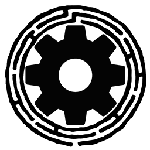

    

    
    
    
    

<strong>Requires the latest version of <a href="https://github.com/CBATeam/CBA_A3/releases/latest">CBA</a> and <a href="https://github.com/acemod/ACE3/releases/latest">ACE3</a>.</strong>

**Theseus Mods** is a joint effort by the members of <a href="https://www.theseus-aegis.com/">Theseus Inc.</a> to bend the features and game-play of Arma 3 to the community's needs.

The mod is on the same foundation as the ACE3 mod, using its framework, systems, tools and standards. It is entirely **open-source** and licensed under the GNU General Public License ([GPLv2](https://github.com/Theseus-Aegis/Mods/blob/master/LICENSE)).

Huge appreciation and thanks to [ACE3 Team](https://ace3mod.com/team.html) for their open-source nature and permission to use their systems.

## Setup

### Requirements

- Arma 3
- Arma 3 Tools (available on Steam)
- Run Arma 3 and Arma 3 Tools directly from Steam once to install registry entries (and again after every update)
- [HEMTT](https://github.com/BrettMayson/HEMTT/releases) (>=v1.5.1) in project root _(Windows users can double-click `tools/setup.bat`)_
  - `hemtt` (Linux) or `hemtt.exe` (Windows)

### Procedure

_Replace `hemtt` with `hemtt.exe` on Windows._

- Open terminal (Linux) or command line (Windows)
- Run `$ hemtt build` to create a development build _(Windows users can double-click `build.bat`)_
- Run `$ hemtt release` to create a release build
  - **Add extension builds from [CI](https://github.com/Theseus-Aegis/Mods/actions/workflows/extensions.yml)!**
- Run `$ hemtt dev` to create a development build with file patching
  - `mklink /J <Arma 3>\x\tac <Mods>/.hemttout/dev` _(`/D` instead of `/J` for network paths)_
  - _`$ hemtt launch` is not supported. Use [ArmaQDL](https://github.com/jonpas/ArmaQDL)._

### Extensions

**Requirements:**
- Rust (>= 1.70)

Extensions builds must be invoked manually or via CI:
- Run `$ cargo build [--release]` in `extensions` directory
- Run `$ cargo test` in `extensions` directory

- `tac_apollo_client`: loaded by players' games, reads players' loadouts, lockers, items and trainings from Minotaur's game API (`https://api.theseus-aegis.com/game/v1/client`).
- `tac_apollo_server`: loaded by game servers (replaces `jni` and `Apollo.jar`), saves and loads players, vehicles and lockers through Minotaur's game API.
  - Put `tac_apollo_server_x64.so` (or `.dll`) next to the server executable and remove `jni_x64.so`, `Apollo/` and `apollo.properties`.
  - Settings: `APOLLO_SERVER_URL` (default `http://minotaur:8000/game/v1/server`) and `APOLLO_SERVER_TOKEN`, or `apollo-server.cfg` next to the server executable with `url = ...` and `token = ...` lines. The token comes from Minotaur's admin (Game persistence › Game servers); a test server is set up there as debug.
  - Log: `logs/tac_apollo_server.log`.
  - End-to-end test against a running Minotaur: see `extensions/apollo-server/tests/minotaur.rs`.
